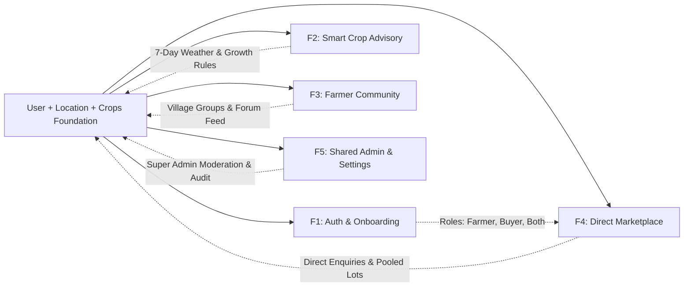

# AgriMitra | ಕೃಷಿಮಿತ್ರ

**AgriMitra** is a production-ready, multilingual rural agricultural platform tailored for the Cauvery basin agricultural belt in **Mandya District, Karnataka**. It seamlessly integrates **Smart Crop Advisory**, **Farmer Community Discussion & Village Collectives**, **Farmer-to-Buyer Direct Marketplace**, and **Platform Administration & Content Governance** on a shared data foundation of `User + Location + Crops`.

* **Pilot Region:** Mandya District, Karnataka (7 Taluks: Mandya, Maddur, Malavalli, Pandavapura, Srirangapatna, KR Pet, Nagamangala)
* **Languages:** Kannada (ಕನ್ನಡ) & English
* **Architecture:** React 18 PWA + FastAPI Python + PostgreSQL 16 + Docker

---

## Key Modules & Capabilities



### 1. F1 – Authentication & Onboarding
* Bilingual onboarding journey (Kannada / English) with progress indicator.
* Mobile phone & password authentication with clearly labelled demonstration OTP flow (`123456`).
* Granular role selection: **Farmer**, **Buyer / Merchant**, or **Both**.
* Mandya 5-level location hierarchy: `State (Karnataka) -> District (Mandya) -> Taluk -> Hobli -> Village`.
* Farm land holding & irrigation selection, buyer enterprise details, and rural fair-trade charter consent.

### 2. F2 – Smart Crop Advisory
* Explainable, rule-based agronomic advisory engine for Mandya staple crops (Sugarcane, Paddy, Ragi, Tender Coconut, Tomato, Banana).
* Live 7-day weather forecast integration with Open-Meteo and local caching.
* Growth-stage irrigation guidance and pest & disease alerts.
* My Crops CRUD management and searchable Crop Knowledge Library.
* Preliminary AI Disease Doctor preview screen with clear RSK agricultural disclaimer.

### 3. F3 – Farmer Community
* Village-based farmer groups across Mandya taluks with join approvals and role permissions (Admin, Moderator, Member).
* Discussion forum feed with filters by crop, topic category, taluk, and village.
* Rich discussion posts with images, threaded comments, likes, and bookmarks.
* Community moderation with inappropriate content reporting.

### 4. F4 – Farmer-to-Buyer Marketplace
* Produce listings with crop variety, quantity, units, expected pricing, harvest date, and collection point.
* **Collective Pooled Listings:** Village groups combine lots for bulk institutional sales.
* Searchable marketplace browsing with multi-criteria filtering and price sorting.
* Direct purchase enquiries with in-app counter-offer negotiation threads and status workflow (`Pending` -> `Accepted` / `Declined` -> `Closed`).
* Farmer "My Listings" management with pause, reactivate, and sold toggles.

### 5. F5 – Shared Features, Settings & Platform Administration
* **Notification Center:** Categorized inbox (`Advisories`, `Marketplace`, `Community`, `System`), unread badges, mark-all-read, and deep links.
* **User Settings & Rural Accessibility:**
  * Dynamic text size scaling: Small, Standard, and **Large (112% high-contrast)** for elderly farmers.
  * **Data Saver Mode:** Optimizes image rendering and graphic asset bandwidth for rural 2G/3G connectivity.
  * Phone number visibility privacy toggle for verified buyer views.
  * Dual-role switcher (`Farmer Mode` <-> `Buyer Mode`).
* **Help Centre & Extension Helplines:**
  * Searchable FAQs and Mandya extension helplines (KVK V.C. Farm, JDA Mandya, RSK Maddur, Kisan Call Centre `1800-180-1551`).
  * Support ticket submission form (`POST /support/tickets`) and resolution tracking.
* **Protected Super Admin Dashboard (`/admin`):**
  * Strict backend `HTTP 403 Forbidden` authorization guard.
  * 8 live platform overview metrics (users, farmers, buyers, listings, groups, reports, tickets, advisories).
  * User management with **Verified Farmer** and **Agri Expert** trust badges.
  * Content moderation queue with **Take Down Content** and immutable audit logging.
  * Crop metadata management (e.g. Mulberry / ಹಿಪ್ಪುನೇರಳೆ).

---

## Technology Stack

| Layer | Technologies |
| :--- | :--- |
| **Frontend** | React 18, TypeScript, Vite, Tailwind CSS, Lucide Icons, shadcn/ui patterns |
| **Routing & State** | React Router v6, TanStack Query v5 (React Query) |
| **Forms & Validation**| React Hook Form, Zod v3 |
| **Internationalization**| `react-i18next` (Kannada default, English toggle, Noto Sans Kannada) |
| **Offline & PWA** | `vite-plugin-pwa`, Workbox service worker precaching |
| **Mock API** | Mock Service Worker (MSW v2) with authentic Mandya demonstration datasets |
| **Backend API** | Python 3.10, FastAPI, Pydantic v2, Uvicorn, OpenAPI 3.1.0 |
| **Database & ORM** | PostgreSQL 16 (production), SQLite (local dev), SQLAlchemy 2.0, Alembic |
| **Testing** | Pytest (backend), Playwright (frontend E2E across Desktop & Mobile Chrome) |
| **Packaging & Deploy**| Multi-stage Dockerfile, Docker Compose, Render Blueprint (`render.yaml`) |

---

## Project Structure

```
d:\AgriMitra/
├── frontend/                     # React 18 + TypeScript PWA
│   ├── public/                   # Static assets, PWA manifest, MSW mockServiceWorker.js
│   ├── src/
│   │   ├── api/                  # Typed API client, service endpoints, OpenAPI spec
│   │   ├── components/           # UI components by domain (advisory, community, marketplace, help, notifications)
│   │   ├── context/              # AuthContext (sessions, dual-role switcher)
│   │   ├── hooks/                # useAgriQuery TanStack Query hooks
│   │   ├── i18n/                 # react-i18next configuration, kn.json, en.json
│   │   ├── mocks/                # MSW worker handlers & Mandya demo data
│   │   ├── pages/                # Page components: Home, Advisory, Community, Market, Profile, Admin, Auth
│   │   ├── routes/               # React Router index & AppShell layout
│   │   └── types/                # TypeScript interfaces matching OpenAPI schema
│   ├── tests/                    # Playwright end-to-end test suites (F1–F5)
│   ├── package.json
│   └── vite.config.ts
├── backend/                      # Python FastAPI Service
│   ├── app/
│   │   ├── api/                  # Routers: health, auth, locations, crops, weather, advisory, community, market, notifications, profile, support, admin
│   │   ├── core/                 # Settings, database engine, security
│   │   ├── db/                   # Seed script initializing authentic Mandya taluks & personas
│   │   ├── models/               # SQLAlchemy 2.0 database models
│   │   ├── schemas/              # Pydantic v2 validation schemas
│   │   └── main.py               # FastAPI entrypoint, CORS, static mounting
│   ├── alembic/                  # Database migration scripts (000 through 004)
│   ├── requirements.txt
│   └── tests/                    # Pytest test suite (26 passing tests)
├── docker/
│   └── Dockerfile.app            # Multi-stage production container bundling frontend + backend
├── Dockerfile                    # Root Dockerfile mirror for standard docker build
├── docker-compose.yml            # Multi-container Compose with persistent PostgreSQL & volume
├── render.yaml                   # Infrastructure-as-code blueprint for Render
├── .env.example                  # Environment configuration template
├── DEPLOYMENT.md                 # Step-by-step production deployment guide
├── TESTING.md                    # Test execution logs and verification matrix
├── PROJECT_STATUS.md             # Feature implementation status & limitations
└── README.md
```

---

## Getting Started

### 1. Instant Demonstration Mode (MSW Browser Sandbox)
Runs the entire frontend with Mock Service Worker simulating authentic Mandya datasets. No database or Python installation required.

```bash
cd frontend
npm install
npm run dev
```
Open **[http://localhost:5173](http://localhost:5173)** in your browser.

---

### 2. Local Full-Stack Development

**Start Backend (FastAPI):**
```bash
cd backend
python -m pip install -r requirements.txt
python -m uvicorn app.main:app --reload --port 8000
```
* Interactive API Documentation (Swagger): [http://localhost:8000/api/v1/docs](http://localhost:8000/api/v1/docs)
* Health Check: [http://localhost:8000/api/v1/health](http://localhost:8000/api/v1/health)

**Start Frontend (React):**
```bash
cd frontend
npm install
npm run dev
```

---

### 3. Docker Compose (Production Multi-Container Setup)

To run the complete production-packaged application with PostgreSQL:

```bash
# 1. Copy environment configuration
cp .env.example .env

# 2. Build and start containers
docker compose up -d --build

# 3. View logs
docker compose logs -f app
```
* Web Application: [http://localhost:8000](http://localhost:8000)
* Health Check: [http://localhost:8000/api/v1/health](http://localhost:8000/api/v1/health)
* PostgreSQL Database: `localhost:5432` (`agrimitra_db`) with persistent named volume `postgres_data`.

---

## Testing & Quality Assurance

### Run Backend Tests (Pytest)
```bash
cd backend
python -m pytest tests
```
* **Status:** All 26 tests passing in ~2.1 seconds.

### Run Frontend Type Check & Production Build
```bash
cd frontend
npm run build
```
* Runs `tsc -b && vite build`. Zero TypeScript errors. Precache PWA manifests generated.

### Run Playwright End-to-End Tests
```bash
cd frontend
npm run test:e2e
```
* Runs 62 end-to-end tests covering F1–F5 across Desktop Chromium and Mobile Chrome.

---

## Deployment & Documentation Links

* [DEPLOYMENT.md](file:///d:/AgriMitra/DEPLOYMENT.md): Complete instructions for Docker Hub, Render, and Managed PostgreSQL.
* [TESTING.md](file:///d:/AgriMitra/TESTING.md): Verification report and test execution matrix.
* [PROJECT_STATUS.md](file:///d:/AgriMitra/PROJECT_STATUS.md): Current release status, simulated features, and roadmap.
* [f5_shared_admin_implementation_report.md](file:///C:/Users/Kavana/.gemini/antigravity/brain/c681cc85-4a07-4bab-8f6f-c622293bb831/f5_shared_admin_implementation_report.md): Phase F5 implementation details.

---

## License & Attribution

AgriMitra is developed for the Mandya Agricultural Pilot in Karnataka. Weather data is provided via Open-Meteo / KSNMDC agro-weather feeds. Map and administrative hierarchy based on Survey of India / Karnataka Revenue Department data.
